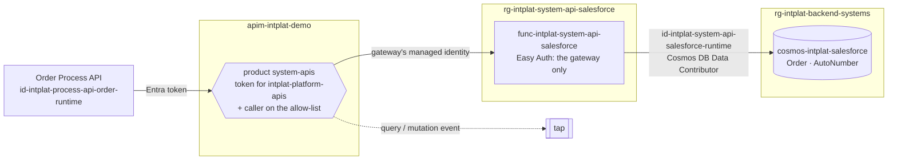

# system-api-salesforce

The **[Sales] Salesforce System API**: orders as Salesforce keeps them (Salesforce is the system of
record for orders), in the platform's contract. Owned by the **sales team**. A Python Function on
Flex Consumption.

| File | What |
|---|---|
| [`openapi.yaml`](openapi.yaml) | The contract (adidas API guidelines, checked by the platform) |
| [`function_app.py`](function_app.py) | The routes: create, retrieve, list, replace |
| [`salesforce.py`](salesforce.py) | Salesforce's data model in Cosmos DB, and the mapping to the contract |
| [`contract.py`](contract.py) | Request bodies are validated against `openapi.yaml` itself |
| [`infra/`](infra/) | Function (Flex Consumption), storage, Easy Auth |
| [`docs/problems/`](docs/problems/) | Problem types |

## Where it sits

System APIs are internal ([ADR 0014](https://github.com/azure-intelligence-domain/ai-intelligence-domain/blob/main/docs/adr/0014-process-layer-split.md)):
building blocks reach them through the people gateway's `system-apis` product with an Entra
token, never directly, and never with a key.

| Check | Who | Else |
|---|---|---|
| Correlation-Id | Gateway (and the Function) | `400` |
| Token for `api://intplat-platform-apis`, client on the allow-list | Gateway, product `system-apis` | `401 Platform Token Required` |
| Caller is a gateway | Easy Auth on the Function | `401` |
| Data rights | Cosmos DB RBAC: only this API's runtime identity | `403` |

## The contract and Salesforce

The API speaks the contract; Salesforce keeps its own model
([backend-systems/salesforce](https://github.com/azure-intelligence-domain/backend-systems/tree/main/salesforce)).

| Contract | Salesforce |
|---|---|
| `orderId` `4711` | `OrderNumber` (auto-number, first after a fresh build: 4711) |
| `recordId` | `id` `801Ad0000004711AAA` |
| `customerId` | `AccountId` |
| `status` | `Order_Status__c`, and Salesforce's own `Status` (`Draft`, `Activated`, `Cancelled`) |
| `orderLines[]` | `OrderItems[]` (`Product2Id`, `Quantity`, `UnitPrice`) |
| `totalAmount` | `TotalAmount` + `CurrencyIsoCode`, computed by Salesforce |
| `deliveryAddress` | `ShippingStreet`, `ShippingPostalCode`, `ShippingCity`, `ShippingCountryCode` |

| Operation | | Notes |
|---|---|---|
| Create Order | `POST /orders` | `201`, `Location`, `ETag` |
| Retrieve Order | `GET /orders/{orderId}` | `ETag` for the next replace |
| Retrieve List of Orders | `GET /orders?customerId=&status=&idempotencyKey=&offset=&limit=` | HAL paging, newest first |
| Replace Order | `PUT /orders/{orderId}` with `If-Match` | `412` if the order changed meanwhile |

A System API translates; it does not decide. Which status may follow which is the Order Process
API's business; this API stores what it is given.

## Pipeline

`.github/workflows/deploy.yml`: contract check and tests, then on `main` (OIDC as
`id-intplat-system-api-salesforce`): Bicep, code (dependencies packaged on the runner), and two smoke tests: the Function
refuses a call that did not come through the gateway, and the gateway refuses a caller without a
platform token. Ends with a deployment event.
